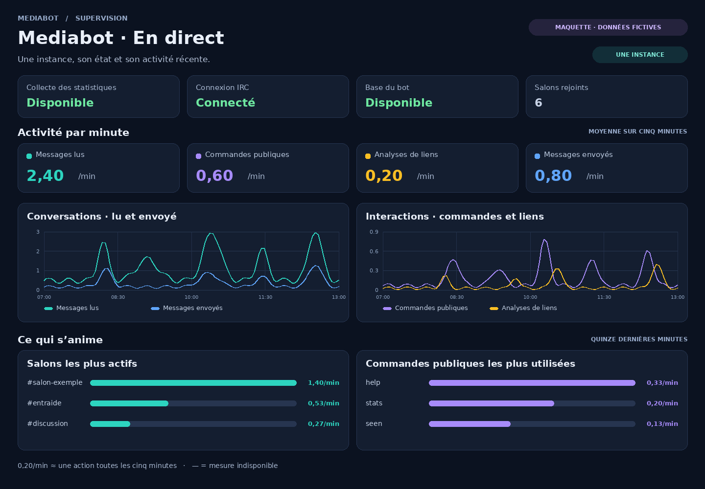

# Mediabot · En direct — Grafana for one bot

[Lire le guide en français](INSTANCE_MINUTE.fr.md) · [Dashboard JSON](grafana_mediabot_instance_minute.json)

This dashboard shows whether your bot is being monitored, whether it is
connected to IRC, whether its database is available, and how many channels
it has joined. It also shows messages, public commands and link analysis
requests per minute. It selects one bot at a time.



The interface is in French. The image illustrates the layout with fictional data.

You need a running Mediabot, Prometheus and a Grafana account that can import
dashboards. Mediabot 3.7 already exposes the metrics used here. The dashboard
can be imported from this repository without upgrading a running 3.7 bot.
It uses Grafana's built-in panels and needs no extra plugin.

The examples assume the services run on the same host and in the same
network namespace. If you already collect your bot in Prometheus, start at
[step 3](#3-connect-grafana-and-import-the-dashboard).

## 1. Enable the metrics on your bot

Open the configuration file used by your instance. Update its existing
`[metrics]` section:

```ini
[metrics]
METRICS_ENABLED=1
METRICS_BIND=127.0.0.1
METRICS_PORT=9108
```

Use a free port if another local bot already uses `9108`. Restart the bot
using its normal service manager. With the
[Mediabot systemd template](../../tools/systemd/README.md), replace
`mybot` with your instance name:

```bash
sudo systemctl restart mediabot@mybot.service
```

On the bot's host, check that the exporter responds:

```bash
curl -fsS http://127.0.0.1:9108/metrics | grep '^mediabot_up 1$'
```

You should see `mediabot_up 1`. This confirms that the exporter is up;
the IRC connection has a separate indicator in the dashboard.

## 2. Tell Prometheus where to collect

Add this job **under the existing** `scrape_configs:` in your
`prometheus.yml`. If you already have a job named `mediabot`, add your
target to that job instead of defining it twice. Match the address and
port used in step 1.

```yaml
scrape_configs:
  - job_name: mediabot
    scrape_interval: 30s
    static_configs:
      - targets: ["127.0.0.1:9108"]
```

Run `promtool check config /etc/prometheus/prometheus.yml`, substituting the
path used by your Prometheus. Reload Prometheus using your installation's
normal procedure. For a systemd unit that supports reload, use
`sudo systemctl reload prometheus.service`. Check **Status → Targets** in
Prometheus, or open `/targets` on its web UI. The bot's target should be **UP**.
Use a collection interval of one minute or less for this dashboard.

If Prometheus runs on another host or in another container, loopback points
back to that collector. Use an address reachable from Prometheus over a
private network or tunnel and bind the exporter accordingly. Keep the
metrics endpoint private: it can reveal channel names and operational data.

## 3. Connect Grafana and import the dashboard

1. If Grafana already has the correct Prometheus data source, keep it.
   Otherwise open **Connections → Data sources**, add a **Prometheus**
   source, enter the URL reachable from the Grafana server (for example
   `http://127.0.0.1:9090` on the same host), then click **Save & test**.
2. Download the [dashboard JSON](grafana_mediabot_instance_minute.json).
   On GitHub, use **Download raw file** so you get the JSON, not the file page.
3. Open **Dashboards → New → Import** in Grafana. Upload the JSON, choose a
   folder, and import.
4. At the top of the dashboard, select **Source Prometheus** (your data
   source), **Collecte** (your Prometheus job, e.g. `mediabot`), and
   **Instance** (the label shown on the target, often `127.0.0.1:9108`).
   If needed, save these selections as the dashboard defaults.

## Read the numbers

- **Collecte des statistiques**, **Connexion IRC**, **Base du bot**, and
  **Salons rejoints** show collection, IRC, database, and joined channels.
- The activity cards and charts show a **per-minute average over five
  minutes**. A value of `0.20/min` is about one action every five minutes.
- The rankings show up to six channels and six public commands with measured
  activity over the last fifteen minutes. **Analyses de liens** counts
  requests to analyse links, without measuring successful previews.
- Zero means no increase was measured. A dash or gap means the measurement
  is unavailable. **Non mesuré** means a status cannot be determined.
  No message contents are shown.

| What you see | What to check |
| --- | --- |
| `curl` cannot reach the exporter | Check the config file your bot uses, the bind address, and the port. Restart only that instance after a configuration edit. |
| The target is **DOWN** | Open its error in Prometheus **Targets**. Test the exporter address from the Prometheus host or container. |
| **Instance** is empty | Select the right data source and job. Check that the target is **UP** and serving Mediabot's metrics. |
| The rankings are empty or the rates are zero | Wait for at least two scrapes; try a normal message or public command in a joined channel and allow another scrape. A new counter series needs a baseline. |
| Collection is available but IRC is disconnected | Look at your bot's IRC connection and logs. The exporter can respond while the bot is offline on IRC. |

No changes to the bot or its database are needed to remove the dashboard.
Delete the dashboard in Grafana. If the scrape job was added only for it,
remove that job from Prometheus, validate the file, and reload.

Maintainers can regenerate or check the JSON from the repository root:

```bash
python3 contrib/grafana/build_instance_minute.py
python3 contrib/grafana/build_instance_minute.py --check
```

References: [Prometheus configuration](https://prometheus.io/docs/prometheus/latest/configuration/configuration/),
[Grafana Prometheus data source](https://grafana.com/docs/grafana/latest/datasources/prometheus/configure/),
[Grafana dashboard import](https://grafana.com/docs/grafana/latest/visualizations/dashboards/build-dashboards/import-dashboards/).
